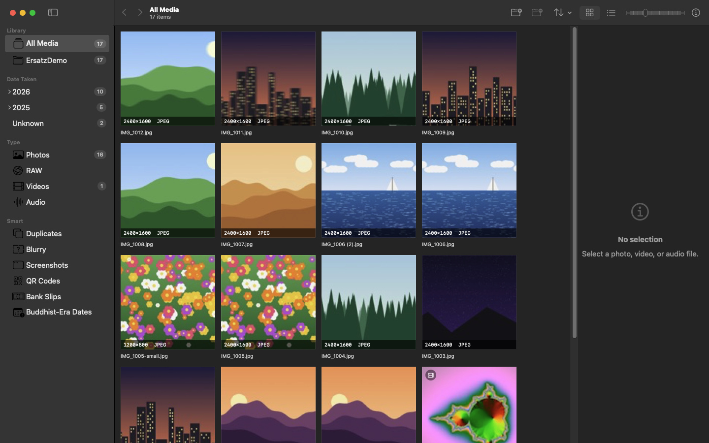

# Ersatz

Ersatz is a native macOS library for photos, RAW, video, and audio. Point it at folders on disk. It indexes them into a local catalog, shows a fast thumbnail grid, and opens stills, video, and sound in one window. Files stay where they are, and the catalog stays on your Mac.

*ภาษาไทยอยู่ด้านล่าง — [ข้ามไปส่วนภาษาไทย](#ersatz-ภาษาไทย)*



## Features

- Indexes ordinary folders: no import, no copies, no moved files. Folders are watched with FSEvents and reindexed incrementally.
- A fast thumbnail grid or a sortable list, with a resolution and format badge on every tile.
- One viewer for photos, RAW, video, and audio, with pan, zoom, and actual-pixel view.
- Plays MKV, WebM, AVI, FLV, and WMV through the ffmpeg you install yourself (optional).
- Smart places: Duplicates, Blurry, Screenshots, QR Codes, Thai bank slips, and Buddhist-Era dates.
- Duplicate cleanup that keeps the original and moves copies to the Trash, never deletes.
- History with checkpoints: every change is logged and can be restored.
- Finder-style Back and Forward with the keyboard, mouse buttons 4 and 5, or a swipe.
- No network code, no accounts, no telemetry.

## Requirements

- macOS 15 or later on Apple Silicon.
- To build: Xcode 16 or later, or another Swift 6 toolchain with the macOS SDK. Developed and tested with Xcode 27 on macOS 27.
- Optional: ffmpeg (`brew install ffmpeg`) for MKV, WebM, AVI, FLV, and WMV. Ersatz does not bundle or link it.

## Install and build

Ersatz is a Swift package with no third-party dependencies. It opens in Xcode, or in VS Code with the Swift extension.

```bash
cd /path/to/Ersatz
swift test
./scripts/bundle.sh
open build/Ersatz.app
```

If `swift` does not find the macOS SDK, point the command-line tools at Xcode once with `xcode-select -s /Applications/Xcode.app` (this needs an administrator).

`scripts/bundle.sh` runs `swift build -c release`, wraps the binary in `build/Ersatz.app` (bundle id `com.mongkol.ersatz`), and ad-hoc signs it so Apple Silicon will launch it. There is no Developer ID signature. `swift run Ersatz` also starts the app while developing.

## Using Ersatz

Add a folder with the toolbar button or File → Add Folder… (Command-O). Ersatz remembers it with a security-scoped bookmark and indexes it in the background. Removing a folder (Command-Delete) only takes it out of the catalog; the files are not touched.

### Sidebar

- **Library**: All Media, then each folder you added with the directories inside it. Picking a folder scopes the other sections to it, and their titles read "Name · library". All Media clears the scope. In the grid, subfolders show as a cover: one photo, or the first three fanned like a small stack.
- **Date Taken**: year, then month, plus **Unknown** for files without a capture date. Dates are stored in the Gregorian calendar.
- **Type**: Photos, RAW, Video, Audio.
- **Smart**: Duplicates, Blurry, Screenshots, QR Codes, Bank Slips, Buddhist-Era Dates.

Sort by name, date taken, date modified, file size, resolution (pixel count), codec, or file type. Missing values sort last. The info panel (Command-I) is the column to the right of the grid.

### Viewer

Space or Return opens the selected item; Space or Esc closes it. The arrow keys move to the previous or next item. Drag pans a photo, the scroll wheel or a trackpad pinch zooms, and a double-click toggles between fit and actual pixels. Stills and RAW are decoded up to a pixel cap (about 3200 px on the long edge when fitted, 8192 px at actual size). Audio has play, pause, and a scrubber.

### Video formats and ffmpeg

Video that AVFoundation can play uses the system player. MKV, WebM, AVI, FLV, and WMV go through ffmpeg on your Mac: Ersatz looks in `/opt/homebrew/bin`, then `/usr/local/bin`, then `PATH`, or uses the path set in Settings. It converts the file into a cached MP4 for playback, with progress and Cancel, and never modifies the original. Indexing reads resolution, codec, and duration with ffprobe, and the thumbnail is one ffmpeg frame. Without ffmpeg those files stay listed as Video and the viewer shows how to install it; reindex afterwards to fill in the details.

### Smart places and analysis

Analysis runs only on demand: when you open a Smart place, or choose Library → Analyze Library. Each place computes only what it needs, and unchanged files are skipped next time. Leaving a Smart place stops its pass; an Analyze Library pass keeps running until it is done or you choose Library → Stop Analyzing (Command-.). While folders are still being indexed, analysis waits.

- **Blurry** scores each photo from 0 (blurry) to 100 (sharp) by how wide its edges are, tile by tile, so a sharp subject on a soft background still counts as sharp. The threshold slider runs from 10 to 90 (default 45), with a Default button.
- **Screenshots** uses the file name and common Mac and iPhone screen sizes for PNGs without a camera model.
- **QR Codes** and **Bank Slips** (Thai transfer slips) use Apple's Vision framework on the Mac.
- **Buddhist-Era Dates** needs no analysis: an EXIF year above 2400 is read as Buddhist Era and stored as year − 543.

### Duplicates and Trash

Duplicates shows numbered sets. **Exact copies** have the same size and SHA-256 hash; **Look alike** photos have nearly the same perceptual hash, for example a resized copy. Videos match only as exact copies. Each set shows how much space removing the copies would free.

Ersatz suggests which file to keep. For exact copies that is the oldest file, then the shorter path. For look-alikes it is the one with the most pixels, then the larger file, then the oldest. **Keep Original, Trash the Copy** (or **Trash N Copies**) applies that choice; a row's context menu has **Keep This One, Trash the Others…**. **Move to Trash…** is also in the Library menu and in the grid, list, and viewer context menus.

Ersatz always asks first, moves files to the macOS Trash (it never deletes them), and records each move so History can put the file back.

### History

View → History (Command-Shift-H) lists every change with a checkpoint. You can restore a whole checkpoint or a single file, search the list, and reveal the activity log in Finder. Old checkpoints are pruned at launch or with Prune Now: keep 1 to 365 days (default 30). The size limit (0.5 to 50 GB, default 2 GB) counts stored file backups; today's changes only store metadata and Trash locations, so in practice the day limit decides.

View → Fix Buddhist-Era Dates… lists files whose year was corrected. Nothing is written until you confirm. ImageIO updates the date in the file when it can; otherwise Ersatz writes an `.xmp` sidecar. The original date is kept in the checkpoint.

## Keyboard and mouse

| Key or gesture | Action |
| --- | --- |
| Space | Open or close the viewer |
| Return or Enter | Open the viewer |
| Esc | Close the viewer |
| Left / Right | Previous / next item |
| Up / Down | Move by a row in the grid, or through the list |
| Command-[ / Command-] | Back / Forward |
| Mouse buttons 4 / 5, swipe left / right, toolbar arrows | Back / Forward |
| Command-O | Add Folder… |
| Command-Delete | Remove the selected folder from the library |
| Command-I | Show or hide the info panel |
| Command-1 / Command-2 | Grid / list |
| Command-+ / Command-- | Bigger / smaller thumbnails |
| Command-R | Reindex |
| Command-. | Stop Analyzing |
| Command-Shift-H | History |
| Command-, | Settings |

Analyze Library, Move to Trash…, and Fix Buddhist-Era Dates… have no shortcut. Back and Forward work like Finder: they move between the places you visited, and opening the viewer counts as a step, so Back closes it and Forward opens it again. Moving between items with the arrow keys does not add steps.

## Settings

Settings (Command-,) has two options:

- **ffmpeg**: a custom path. Leave it blank to search `/opt/homebrew/bin`, then `/usr/local/bin`, then `PATH`.
- **Playback cache**: 1 to 100 GB (default 5 GB). When the converted videos pass this size, the oldest are removed first.

## Privacy

Ersatz has no network code: no update checks, no analytics, no accounts. It reads the folders you add and writes only its own catalog, caches, and log (below). The only outside programs it runs are the ffmpeg and ffprobe you installed. Vision analysis runs on your Mac.

## Where data is stored

| What | Path |
| --- | --- |
| Catalog and checkpoints | `~/Library/Application Support/Ersatz/library.sqlite` |
| Thumbnails | `~/Library/Caches/Ersatz/Thumbnails` |
| Playback cache | `~/Library/Caches/Ersatz/Playback` |
| Activity log | `~/Library/Logs/Ersatz/activity.log` |

## Known gaps

- The app is not sandboxed. Security-scoped bookmarks are still created and restored so a later sandbox keeps folder access.
- Symbolic links are not followed. Hidden files, AppleDouble `._` files, and bundle packages are skipped.
- If two library folders overlap, the index that ran last owns each path.
- A filesystem event rescans that folder incrementally; it does not patch a single file.
- Orphan thumbnail files are not purged when an item leaves the catalog.
- HEIC, CR3, and other formats the portable parser does not fully read rely on ImageIO or AVFoundation.
- Capture dates are stored as Gregorian dates and shown in your Mac's calendar, so a Thai Buddhist calendar shows the corrected year in BE.
- No albums, ratings, or photo editing.
- The bundle is ad-hoc signed; there is no Developer ID signature or notarization.
- One window.

## Development

```
Package.swift
Sources/CSQLite/          system SQLite module map
Sources/ErsatzCore/       catalog, parsers, indexer, analysis, sorting
Sources/Ersatz/           SwiftUI app (macOS)
Tests/ErsatzCoreTests/    unit tests and generated sample files
Resources/                Info.plist and the app icon
scripts/bundle.sh
```

`ErsatzCore` also builds on Linux (`sudo apt install libsqlite3-dev`, then `swift test`), so most tests run without a Mac; the window app is macOS-only. SQLite is the system library, not a third-party wrapper.

Indexing writes a basic catalog row first so files appear at once, then reads metadata in a worker pool (at least two workers, one per processor). Thumbnails (up to half the cores, at least four at a time) and analysis (up to half, at least one) share a work gate, and thumbnails always go first. File headers (JPEG EXIF, PNG, GIF, BMP, TIFF-based RAW, WAV, AIFF, FLAC, MP3, MP4/QuickTime) are parsed in `ErsatzCore`; on a Mac, ImageIO, AVFoundation, Core Image, and QuickLook fill the gaps.

For ffmpeg playback, H.264 or HEVC with AAC, Apple Lossless, MP3, AC-3, E-AC-3, or no audio is remuxed losslessly (`-c copy`, HEVC tagged `hvc1`, `-movflags +faststart`). Anything else is transcoded with VideoToolbox (`h264_videotoolbox` or `hevc_videotoolbox`) and AAC. The cache is keyed by path, size, and modification time.

**Testing.** `swift test` runs 120 tests on macOS (round 11). They cover the catalog and migrations, Buddhist-Era dates, sorting, hashing and duplicate grouping, blur scoring, screenshot and slip rules, the analysis planner, Back/Forward history, checkpoints and pruning, ffmpeg arguments and progress parsing, and the playback-cache limit. The ffmpeg tests do not launch ffmpeg.

**Demo catalog.** For screenshots or experiments, launch with `ERSATZ_DATA_DIR=/tmp/ErsatzDemoData` or `-ErsatzDataDir /tmp/ErsatzDemoData`. The catalog, caches, and log then live there instead of `~/Library`. Only with a data directory set, `-ErsatzAddFolder <path>`, `-ErsatzStartFilter <place>`, `-ErsatzOpenViewer`, `-ErsatzWindowSize 1600x1000`, and `-ErsatzSnapshot <file.png>` (with `-ErsatzSnapshotDelay <seconds>`) are honoured. The README screenshots were made this way from generated images, not real photos.

## Inspiration and credits

Ersatz is inspired by [Diffractor](https://diffractor.com), a fast, free photo and video organizer for Windows by Zac Walker ([source on GitHub](https://github.com/ZacWalk/diffractor)). Diffractor's source is licensed under the LGPL 2.1 or later, and its released binaries under the LGPL 3.0 or later. It shaped the idea: a local library over ordinary folders, a fast thumbnail grid, one viewer for photos, video, and audio, and tools such as duplicate detection.

Ersatz is a separate app written from scratch in Swift and SwiftUI for macOS. It is not a port of Diffractor, and it contains no Diffractor code, icons, or other assets; the interface uses Apple's SF Symbols. The name only means "a stand-in". Ersatz is not affiliated with, sponsored by, or endorsed by Zac Walker or the Diffractor project. On Windows, Diffractor itself is the natural choice.

## License

MIT. See [LICENSE](LICENSE).

---

# Ersatz (ภาษาไทย)

Ersatz คือโปรแกรมบน macOS สำหรับจัดระเบียบรูปภาพ ไฟล์ RAW วิดีโอ และเสียง เลือกโฟลเดอร์บนดิสก์ แล้วโปรแกรมจะทำดัชนีเก็บไว้ในเครื่อง แสดงตารางภาพย่อที่เร็ว และเปิดภาพ วิดีโอ หรือเสียงในหน้าต่างเดียว ไฟล์อยู่ที่เดิม แคตตาล็อกอยู่บน Mac ของคุณ

## ความสามารถ

- ทำดัชนีจากโฟลเดอร์ปกติ ไม่ต้องนำเข้า ไม่ก็อปปี้ ไม่ย้ายไฟล์ เฝ้าโฟลเดอร์ด้วย FSEvents และทำดัชนีใหม่เฉพาะส่วนที่เปลี่ยน
- ตารางภาพย่อหรือรายการที่เรียงได้ ทุกช่องมีป้ายความละเอียดและฟอร์แมต
- ตัวดูเดียวสำหรับภาพ RAW วิดีโอ และเสียง เลื่อน ซูม และดูขนาดจริงได้
- เล่น MKV, WebM, AVI, FLV, WMV ผ่าน ffmpeg ที่คุณติดตั้งเอง (ไม่บังคับ)
- หมวดอัจฉริยะ: ไฟล์ซ้ำ รูปเบลอ ภาพหน้าจอ คิวอาร์โค้ด สลิปโอนเงินไทย และวันที่แบบ พ.ศ.
- ล้างไฟล์ซ้ำโดยเก็บต้นฉบับไว้ และย้ายสำเนาไปถังขยะ ไม่ลบทิ้ง
- ประวัติพร้อม checkpoint ทุกการเปลี่ยนถูกบันทึกและกู้คืนได้
- ย้อนกลับ/ไปข้างหน้าแบบ Finder ด้วยคีย์บอร์ด ปุ่มเมาส์ 4 และ 5 หรือการปัด
- ไม่มีโค้ดเครือข่าย ไม่มีบัญชี ไม่มีการเก็บสถิติ

## สิ่งที่ต้องมี

- macOS 15 ขึ้นไป บน Apple Silicon
- สำหรับ build: Xcode 16 ขึ้นไป หรือ toolchain Swift 6 ที่มี macOS SDK (พัฒนาและทดสอบกับ Xcode 27 บน macOS 27)
- ไม่บังคับ: ffmpeg (`brew install ffmpeg`) สำหรับ MKV, WebM, AVI, FLV, WMV โดย Ersatz ไม่ได้รวมหรือลิงก์ ffmpeg มาด้วย

## ติดตั้งและ build

Ersatz เป็น Swift package ที่ไม่พึ่งไลบรารีภายนอก เปิดได้ใน Xcode หรือ VS Code (ส่วนขยาย Swift)

```bash
cd /path/to/Ersatz
swift test
./scripts/bundle.sh
open build/Ersatz.app
```

ถ้า `swift` หา macOS SDK ไม่เจอ ให้ชี้ command-line tools ไปที่ Xcode ครั้งเดียวด้วย `xcode-select -s /Applications/Xcode.app` (ต้องใช้สิทธิ์ผู้ดูแลระบบ)

`scripts/bundle.sh` รัน `swift build -c release` ห่อไบนารีเป็น `build/Ersatz.app` (bundle id `com.mongkol.ersatz`) แล้วเซ็นแบบ ad-hoc เพื่อให้ Apple Silicon เปิดได้ ไม่มีลายเซ็น Developer ID ระหว่างพัฒนาใช้ `swift run Ersatz` ได้

## วิธีใช้ Ersatz

เพิ่มโฟลเดอร์ด้วยปุ่มบนแถบเครื่องมือหรือ File → Add Folder… (Command-O) โปรแกรมจำโฟลเดอร์ด้วย security-scoped bookmark แล้วทำดัชนีในพื้นหลัง การเอาโฟลเดอร์ออก (Command-Delete) แค่เอาออกจากแคตตาล็อก ไม่แตะไฟล์

### แถบด้านข้าง

- **Library**: All Media แล้วตามด้วยโฟลเดอร์ที่เพิ่มและไดเรกทอรีข้างใน เลือกโฟลเดอร์แล้วหมวดอื่นจะแสดงเฉพาะโฟลเดอร์นั้น หัวข้อจะเป็น "ชื่อ · library" เลือก All Media เพื่อกลับมาดูทั้งหมด ในตาราง โฟลเดอร์ย่อยแสดงเป็นปก: รูปเดียว หรือสามรูปแรกซ้อนเอียง
- **Date Taken**: ปี แล้วเดือน และ **Unknown** สำหรับไฟล์ที่ไม่มีวันที่ถ่าย วันที่เก็บเป็นปฏิทินเกรกอเรียน
- **Type**: Photos, RAW, Video, Audio
- **Smart**: Duplicates, Blurry, Screenshots, QR Codes, Bank Slips, Buddhist-Era Dates

เรียงตามชื่อ วันที่ถ่าย วันที่แก้ไข ขนาดไฟล์ ความละเอียด codec หรือชนิดไฟล์ได้ ค่าที่ไม่มีอยู่ท้ายสุด แผงข้อมูล (Command-I) คือคอลัมน์ทางขวาของตาราง

### ตัวดู

Space หรือ Return เปิดรายการที่เลือก Space หรือ Esc ปิด ปุ่มลูกศรไปรายการก่อนหน้าหรือถัดไป ลากเพื่อเลื่อนภาพ ใช้ล้อเมาส์หรือบีบนิ้วบนแทร็กแพดเพื่อซูม ดับเบิลคลิกสลับระหว่างพอดีหน้าต่างกับขนาดจริง ภาพนิ่งและ RAW ถอดรหัสไม่เกินเพดานพิกเซล (ด้านยาวราว 3200 px เมื่อพอดีหน้าต่าง 8192 px เมื่อขนาดจริง) ไฟล์เสียงมีปุ่มเล่น หยุดชั่วคราว และแถบเลื่อนเวลา

### ฟอร์แมตวิดีโอและ ffmpeg

วิดีโอที่ AVFoundation เล่นได้ใช้ตัวเล่นของระบบ ส่วน MKV, WebM, AVI, FLV และ WMV ใช้ ffmpeg บน Mac ของคุณ โปรแกรมค้นที่ `/opt/homebrew/bin` แล้ว `/usr/local/bin` แล้ว `PATH` หรือใช้พาธที่ตั้งใน Settings ไฟล์จะถูกแปลงเป็น MP4 ในแคชเพื่อเล่น มีแถบความคืบหน้าและปุ่ม Cancel และไม่แก้ไฟล์ต้นฉบับ ตอนทำดัชนีจะอ่านความละเอียด codec และความยาวด้วย ffprobe และภาพย่อคือหนึ่งเฟรมจาก ffmpeg ถ้าไม่มี ffmpeg ไฟล์เหล่านี้ยังแสดงเป็น Video และตัวดูจะบอกวิธีติดตั้ง ติดตั้งแล้วให้ทำดัชนีใหม่

### หมวดอัจฉริยะและการวิเคราะห์

การวิเคราะห์ทำเมื่อสั่งเท่านั้น คือเมื่อเปิดหมวด Smart หรือเลือก Library → Analyze Library แต่ละหมวดคำนวณเฉพาะสิ่งที่ต้องใช้ และข้ามไฟล์ที่ไม่เปลี่ยน ออกจากหมวด Smart แล้วรอบของหมวดนั้นจะหยุด ส่วน Analyze Library ทำต่อจนเสร็จ หรือจนกว่าจะเลือก Library → Stop Analyzing (Command-.) ระหว่างที่ยังทำดัชนีโฟลเดอร์อยู่ การวิเคราะห์จะรอ

- **Blurry** ให้คะแนนรูปจาก 0 (เบลอ) ถึง 100 (คม) ตามความกว้างของขอบภาพ ดูทีละส่วนของภาพ ดังนั้นรูปที่ตัวแบบคมแต่ฉากหลังนุ่มยังนับว่าคม แถบเกณฑ์ปรับได้ 10 ถึง 90 (ค่าเริ่มต้น 45) และมีปุ่ม Default
- **Screenshots** ดูจากชื่อไฟล์ และขนาดจอ Mac กับ iPhone ที่พบบ่อยสำหรับไฟล์ PNG ที่ไม่มีรุ่นกล้อง
- **QR Codes** และ **Bank Slips** (สลิปโอนเงินไทย) ใช้ Vision ของ Apple บน Mac
- **Buddhist-Era Dates** ไม่ต้องวิเคราะห์: ปีใน EXIF ที่มากกว่า 2400 ถือเป็น พ.ศ. และเก็บเป็นปี − 543

### ไฟล์ซ้ำและถังขยะ

Duplicates แสดงเป็นชุดที่มีหมายเลข **Exact copies** คือไฟล์ที่ขนาดและแฮช SHA-256 ตรงกัน **Look alike** คือรูปที่ perceptual hash เกือบเท่ากัน เช่น รูปที่ถูกย่อขนาด วิดีโอจับคู่ได้เฉพาะแบบตรงกันทุกไบต์ แต่ละชุดบอกว่าจะได้พื้นที่คืนเท่าไร

Ersatz เสนอว่าจะเก็บไฟล์ไหน สำหรับไฟล์ที่ตรงกันทุกไบต์คือไฟล์ที่เก่าที่สุด แล้วพาธที่สั้นกว่า สำหรับรูปที่คล้ายกันคือรูปที่มีพิกเซลมากที่สุด แล้วไฟล์ที่ใหญ่กว่า แล้วไฟล์ที่เก่าที่สุด ปุ่ม **Keep Original, Trash the Copy** (หรือ **Trash N Copies**) ใช้ตัวเลือกนี้ เมนูคลิกขวาของแต่ละแถวมี **Keep This One, Trash the Others…** และ **Move to Trash…** ยังมีในเมนู Library และเมนูคลิกขวาของตาราง รายการ และตัวดู

Ersatz ถามก่อนทุกครั้ง ย้ายไฟล์ไปถังขยะของ macOS (ไม่ลบทิ้ง) และบันทึกทุกการย้าย เพื่อให้ History กู้ไฟล์คืนได้

### ประวัติ

View → History (Command-Shift-H) แสดงทุกการเปลี่ยนพร้อม checkpoint กู้คืนได้ทั้ง checkpoint หรือทีละไฟล์ ค้นหาได้ และเปิดดู activity log ใน Finder ได้ checkpoint เก่าถูกลบตอนเปิดแอปหรือเมื่อกด Prune Now: เก็บไว้ 1 ถึง 365 วัน (ค่าเริ่มต้น 30) เพดานขนาด (0.5 ถึง 50 GB ค่าเริ่มต้น 2 GB) นับเฉพาะไฟล์สำรองที่เก็บไว้ ปัจจุบันการเปลี่ยนเก็บแค่ metadata และตำแหน่งในถังขยะ ในทางปฏิบัติจึงใช้เกณฑ์จำนวนวัน

View → Fix Buddhist-Era Dates… แสดงไฟล์ที่ปีถูกแก้จาก พ.ศ. จะไม่เขียนไฟล์จนกว่าจะยืนยัน ImageIO แก้วันที่ในไฟล์เมื่อทำได้ ไม่เช่นนั้น Ersatz เขียนไฟล์ `.xmp` คู่กัน วันที่เดิมเก็บไว้ใน checkpoint

## คีย์บอร์ดและเมาส์

| ปุ่มหรือท่าทาง | การทำงาน |
| --- | --- |
| Space | เปิดหรือปิดตัวดู |
| Return หรือ Enter | เปิดตัวดู |
| Esc | ปิดตัวดู |
| ลูกศรซ้าย / ขวา | รายการก่อนหน้า / ถัดไป |
| ลูกศรขึ้น / ลง | เลื่อนทีละแถวในตาราง หรือในรายการ |
| Command-[ / Command-] | ย้อนกลับ / ไปข้างหน้า |
| ปุ่มเมาส์ 4 / 5, ปัดซ้าย / ขวา, ลูกศรบนแถบเครื่องมือ | ย้อนกลับ / ไปข้างหน้า |
| Command-O | Add Folder… |
| Command-Delete | เอาโฟลเดอร์ที่เลือกออกจากคลัง |
| Command-I | แสดงหรือซ่อนแผงข้อมูล |
| Command-1 / Command-2 | ตาราง / รายการ |
| Command-+ / Command-- | ภาพย่อใหญ่ขึ้น / เล็กลง |
| Command-R | ทำดัชนีใหม่ |
| Command-. | Stop Analyzing |
| Command-Shift-H | History |
| Command-, | Settings |

Analyze Library, Move to Trash… และ Fix Buddhist-Era Dates… ไม่มีปุ่มลัด การย้อนกลับและไปข้างหน้าทำงานแบบ Finder คือย้ายระหว่างที่ที่เคยเปิด และการเปิดตัวดูนับเป็นหนึ่งขั้น ย้อนกลับจึงปิดตัวดู และไปข้างหน้าเปิดอีกครั้ง การเปลี่ยนรายการด้วยปุ่มลูกศรไม่เพิ่มขั้น

## Settings

Settings (Command-,) มีสองตัวเลือก:

- **ffmpeg**: พาธที่กำหนดเอง เว้นว่างเพื่อค้นที่ `/opt/homebrew/bin` แล้ว `/usr/local/bin` แล้ว `PATH`
- **Playback cache**: 1 ถึง 100 GB (ค่าเริ่มต้น 5 GB) เมื่อวิดีโอที่แปลงแล้วเกินขนาดนี้ ไฟล์ที่เก่าที่สุดจะถูกลบก่อน

## ความเป็นส่วนตัว

Ersatz ไม่มีโค้ดเครือข่าย ไม่ตรวจอัปเดต ไม่เก็บสถิติ ไม่มีบัญชี อ่านเฉพาะโฟลเดอร์ที่คุณเพิ่ม และเขียนแค่แคตตาล็อก แคช และบันทึกของตัวเอง (ด้านล่าง) โปรแกรมภายนอกที่เรียกมีแค่ ffmpeg และ ffprobe ที่คุณติดตั้งเอง การวิเคราะห์ด้วย Vision ทำบน Mac ของคุณ

## ข้อมูลถูกเก็บที่ไหน

| สิ่งที่เก็บ | ที่อยู่ |
| --- | --- |
| แคตตาล็อกและ checkpoint | `~/Library/Application Support/Ersatz/library.sqlite` |
| ภาพย่อ | `~/Library/Caches/Ersatz/Thumbnails` |
| แคชสำหรับเล่นวิดีโอ | `~/Library/Caches/Ersatz/Playback` |
| บันทึกการทำงาน | `~/Library/Logs/Ersatz/activity.log` |

## ข้อจำกัดที่รู้แล้ว

- แอปไม่ได้อยู่ใน sandbox แต่ยังสร้างและกู้ security-scoped bookmark เพื่อให้ sandbox ในอนาคตยังเข้าถึงโฟลเดอร์ได้
- ไม่ตาม symbolic link ข้ามไฟล์ซ่อน ไฟล์ AppleDouble `._` และ bundle
- ถ้าสองโฟลเดอร์ในคลังซ้อนกัน รอบดัชนีล่าสุดเป็นเจ้าของพาธนั้น
- เมื่อมีไฟล์เปลี่ยน จะสแกนโฟลเดอร์นั้นใหม่แบบส่วนเพิ่ม ไม่ได้แก้เฉพาะไฟล์เดียว
- ไฟล์ภาพย่อที่ค้างไม่ถูกลบเมื่อรายการออกจากแคตตาล็อก
- HEIC, CR3 และฟอร์แมตที่ตัวอ่านแบบพกพาอ่านไม่ครบ อาศัย ImageIO หรือ AVFoundation
- วันที่ถ่ายเก็บเป็น ค.ศ. และแสดงตามปฏิทินของ Mac ดังนั้นปฏิทินพุทธจะแสดงปีที่แก้แล้วเป็น พ.ศ.
- ยังไม่มีอัลบั้ม คะแนน หรือการแต่งรูป
- บันเดิลเซ็นแบบ ad-hoc ไม่มีลายเซ็น Developer ID หรือ notarization
- มีหน้าต่างเดียว

## การพัฒนา

โครงสร้างโปรเจกต์ดูที่ส่วนภาษาอังกฤษด้านบน `ErsatzCore` แปลบน Linux ได้ด้วย (`sudo apt install libsqlite3-dev` แล้ว `swift test`) เทสส่วนใหญ่จึงรันได้โดยไม่ต้องมี Mac ส่วนหน้าต่างแอปใช้ได้เฉพาะ macOS SQLite ใช้ไลบรารีของระบบ ไม่ได้ใช้ wrapper ภายนอก

การทำดัชนีเขียนแถวพื้นฐานก่อนเพื่อให้ไฟล์โผล่ทันที แล้วอ่าน metadata ด้วยกลุ่มงาน (อย่างน้อยสองงาน หนึ่งงานต่อตัวประมวลผล) ภาพย่อ (ไม่เกินครึ่งหนึ่งของจำนวนคอร์ อย่างน้อยสี่งาน) และการวิเคราะห์ (ไม่เกินครึ่งหนึ่ง อย่างน้อยหนึ่งงาน) ใช้ประตูงานร่วมกัน และภาพย่อได้ก่อนเสมอ ส่วนหัวไฟล์ (JPEG EXIF, PNG, GIF, BMP, RAW แบบ TIFF, WAV, AIFF, FLAC, MP3, MP4/QuickTime) อ่านใน `ErsatzCore` บน Mac ใช้ ImageIO, AVFoundation, Core Image และ QuickLook เติมส่วนที่ขาด

การเล่นผ่าน ffmpeg: ถ้าภาพเป็น H.264 หรือ HEVC และเสียงเป็น AAC, Apple Lossless, MP3, AC-3, E-AC-3 หรือไม่มีเสียง จะ remux แบบไม่สูญเสีย (`-c copy`, HEVC ติดแท็ก `hvc1`, `-movflags +faststart`) นอกนั้นแปลงด้วย VideoToolbox (`h264_videotoolbox` หรือ `hevc_videotoolbox`) และ AAC แคชอ้างอิงจากพาธ ขนาด และเวลาแก้ไข

**การทดสอบ** `swift test` รัน 120 เทสบน macOS (รอบ 11) ครอบคลุมแคตตาล็อกและการย้ายสคีมา วันที่ พ.ศ. การเรียง แฮชและการจัดกลุ่มไฟล์ซ้ำ คะแนนความเบลอ กฎภาพหน้าจอและสลิป ตัววางแผนการวิเคราะห์ ประวัติย้อนกลับ/ไปข้างหน้า checkpoint และการลบ อาร์กิวเมนต์ ffmpeg และตัวอ่านความคืบหน้า และเพดานแคชวิดีโอ เทส ffmpeg ไม่ได้รัน ffmpeg จริง

**แคตตาล็อกทดลอง** สำหรับถ่ายภาพหน้าจอหรือทดลอง เปิดแอปด้วย `ERSATZ_DATA_DIR=/tmp/ErsatzDemoData` หรือ `-ErsatzDataDir /tmp/ErsatzDemoData` แคตตาล็อก แคช และบันทึกจะอยู่ที่นั่นแทน `~/Library` และเฉพาะเมื่อกำหนดโฟลเดอร์ข้อมูลแล้ว จึงใช้ `-ErsatzAddFolder`, `-ErsatzStartFilter`, `-ErsatzOpenViewer`, `-ErsatzWindowSize` และ `-ErsatzSnapshot` ได้ ภาพหน้าจอใน README นี้ทำจากภาพที่สร้างขึ้น ไม่ใช่รูปจริง

## แรงบันดาลใจและเครดิต

Ersatz ได้แรงบันดาลใจจาก [Diffractor](https://diffractor.com) โปรแกรมจัดระเบียบรูปและวิดีโอบน Windows ที่เร็วและฟรี โดย Zac Walker ([ซอร์สโค้ดบน GitHub](https://github.com/ZacWalk/diffractor)) ซอร์สโค้ดของ Diffractor ใช้สัญญาอนุญาต LGPL 2.1 ขึ้นไป และไบนารีที่เผยแพร่ใช้ LGPL 3.0 ขึ้นไป Diffractor เป็นที่มาของแนวคิด: คลังภาพในเครื่องจากโฟลเดอร์ปกติ ตารางภาพย่อที่เร็ว ตัวดูเดียวสำหรับภาพ วิดีโอ และเสียง และเครื่องมืออย่างการหาไฟล์ซ้ำ

Ersatz เป็นแอปแยกต่างหากที่เขียนใหม่ทั้งหมดด้วย Swift และ SwiftUI สำหรับ macOS ไม่ใช่การพอร์ต Diffractor และไม่มีโค้ด ไอคอน หรือไฟล์อื่นใดของ Diffractor อินเทอร์เฟซใช้ SF Symbols ของ Apple ชื่อ Ersatz แปลว่า "ของทดแทน" เท่านั้น Ersatz ไม่มีส่วนเกี่ยวข้อง ไม่ได้รับการสนับสนุน และไม่ได้รับการรับรองจาก Zac Walker หรือโครงการ Diffractor บน Windows ใช้ Diffractor เองเป็นตัวเลือกที่เหมาะที่สุด

## สัญญาอนุญาต

MIT ดูที่ [LICENSE](LICENSE)
